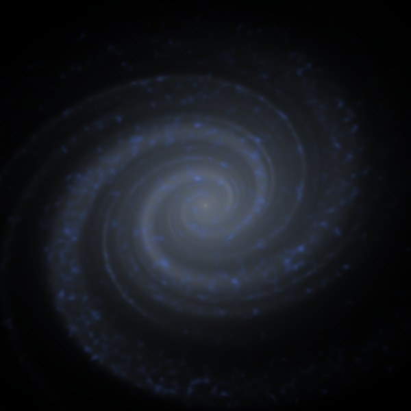
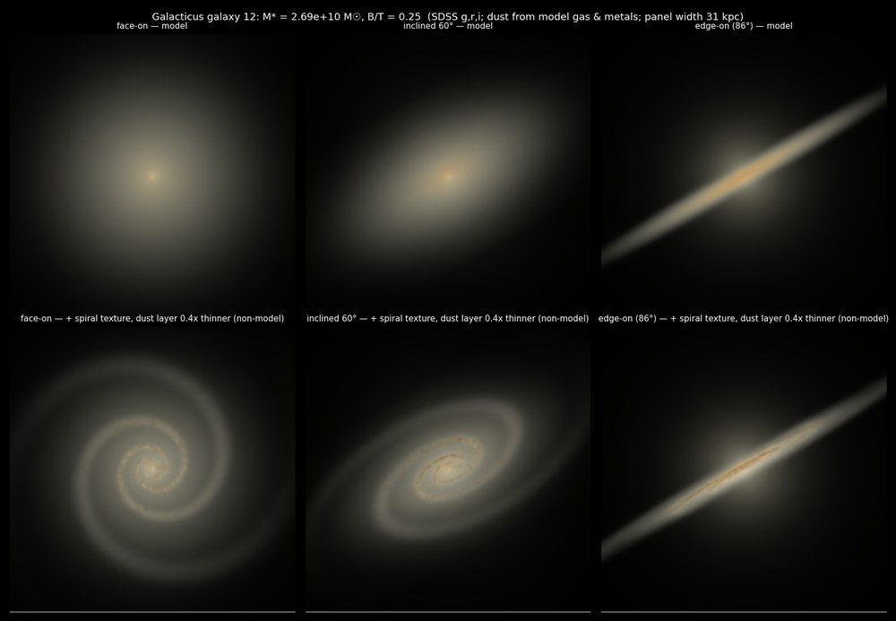

Galaxy images
=============

:mod:`dendros.viz` makes mock images of single Galacticus galaxies, seen from any
direction, in any set of bands. Images are built from the model's own description of
each galaxy:

* the density of each component (disk, spheroid, their stars and gas), tabulated on a
  grid of radius and polar angle by the ``densityProfile`` node property extractor;
* the luminosity of each component in each band, optionally split into light from
  recently formed stars and from older ones;
* the gas mass and metallicity of each component, from which the dust follows.

The galaxy is ray-traced, with the light absorbed by the dust in front of it, and
the bands are combined into a color image.

The visualization tools need ``scipy`` and ``astropy``::

    pip install 'dendros[viz]'

Model requirements
------------------

Galacticus components are axisymmetric and smooth, and the image is built from their
density profiles. Galacticus evaluates these itself, so the images use whatever
profile shapes the model uses, with no assumptions in dendros. The model must output:

``densityProfile`` with ``polarAngles`` and ``includeRadii``
    The density of each component to be drawn, at radii given in units of the
    component's own scale radius, and at a set of polar angles (in degrees from the
    component's axis, so 90 is the midplane). Without ``polarAngles`` only the
    midplane is tabulated, and each component is then drawn as if it were spherical.
    ``polarAngles`` needs a version of Galacticus that provides it.

Stellar luminosities per component
    ``diskLuminositiesStellar:<band>:rest:z0.0000`` and the same for the spheroid, in
    each band to be drawn (by default ``SDSS_g``, ``SDSS_r`` and ``SDSS_i``). If the
    same luminosities are also output for recently formed stars (names ending in
    ``:recent``), young and old light can be placed differently (see
    :ref:`viz-presentation`).

Gas masses and metallicities
    ``diskMassGas`` and ``diskAbundancesGasMetals`` (and the same for the spheroid),
    which are output by default. Dust is drawn only for components whose gas density
    is tabulated.

The grid must cover each component well. For a disk, 40 radii spaced logarithmically
from 0.01 to 10 scale radii and about 20 polar angles packed towards the midplane
recover the total light to better than 0.1%; the vertical structure of a thin disk
lies within a few degrees of the midplane, so the angles must sample it densely.
A suitable parameter file fragment:

.. code-block:: xml

   <nodePropertyExtractor value="multi">
     <nodePropertyExtractor value="nodeIndices"/>
     <nodePropertyExtractor value="indicesTree"/>
     <nodePropertyExtractor value="radiusHalfMassStellar"/>
     <nodePropertyExtractor value="densityProfile">
       <!-- 40 radii each for disk stars, disk gas and spheroid stars (abbreviated here). -->
       <radiusSpecifiers  value="diskRadius:disk:stellar:0.01 ... diskRadius:disk:stellar:10
                                 diskRadius:disk:gaseous:0.01 ... diskRadius:disk:gaseous:10
                                 spheroidRadius:spheroid:stellar:0.003 ... spheroidRadius:spheroid:stellar:30"/>
       <!-- Polar angles packed towards the midplane. -->
       <polarAngles       value="90 89.9 89.8 89.6 89.3 89 88.5 88 87 86 84 82 79 75 70 63 55 45 35 25 15 0"/>
       <includeRadii      value="true"/>
       <zeroRadiusIsFatal value="false"/>
     </nodePropertyExtractor>
   </nodePropertyExtractor>

   <!-- Luminosities of all stars ("default") and of stars formed in the last 100 Myr ("recent"). -->
   <luminosityFilter         value="SDSS_g SDSS_r SDSS_i SDSS_g SDSS_r SDSS_i"/>
   <luminosityType           value="rest rest rest rest rest rest"/>
   <luminosityRedshift       value="0.0 0.0 0.0 0.0 0.0 0.0"/>
   <luminosityPostprocessSet value="default default default recent recent recent"/>
   <stellarPopulationSpectraPostprocessorBuilder value="lookup">
     <names value="default recent"/>
     <stellarPopulationSpectraPostprocessor value="identity"/>
     <stellarPopulationSpectraPostprocessor value="recent">
       <timeLimit value="0.1"/>
     </stellarPopulationSpectraPostprocessor>
   </stellarPopulationSpectraPostprocessorBuilder>

``zeroRadiusIsFatal`` is set to ``false`` so that galaxies lacking a component (and
so with a zero scale radius for it) are output rather than treated as errors.

Making an image
---------------

:func:`~dendros.viz.galaxy_scene` reads one galaxy (a row of an output) into a
:class:`~dendros.viz.GalaxyScene`; :func:`~dendros.viz.render_galaxy` renders it in
each band; and :func:`~dendros.viz.compose_rgb` combines three bands into an 8-bit
color image:

.. code-block:: python

   import matplotlib.pyplot as plt
   from dendros import open_outputs
   from dendros.viz import galaxy_scene, render_galaxy, compose_rgb

   with open_outputs("galaxies.hdf5") as c:
       scene = galaxy_scene(c, "Output1", 9)
   images = render_galaxy(scene, inclination=60.0, position_angle=30.0, npix=512)
   rgb = compose_rgb(images)
   plt.imsave("galaxy.png", rgb, origin="lower")

Each image is the surface brightness in Galacticus luminosity units per pc², so
:func:`~dendros.viz.surface_brightness_magnitudes` converts it to AB mag/arcsec².
``inclination`` is 0 for face-on and 90 for edge-on, and ``position_angle`` rotates
the galaxy in the image plane. ``half_width`` sets the half-width of the image [Mpc];
the default is four stellar half-mass radii.

The rendering
~~~~~~~~~~~~~

Each line of sight is integrated front to back through ``n_steps`` slabs, with the
light of each slab attenuated by the dust in front of it and by the dust within the
slab itself. Dust follows the gas, with a density
:math:`\rho_\mathrm{dust} = f_\mathrm{d/m} Z \rho_\mathrm{gas}`, using the model's gas
metallicity :math:`Z` and a dust-to-metals ratio :math:`f_\mathrm{d/m}` (0.4 by
default). Its opacity is :math:`\kappa_V = 2.1\times10^4\,\mathrm{cm^2\,g^{-1}}`
(Milky Way extinction per hydrogen atom for a dust-to-gas ratio of 0.01), scaling as
:math:`\lambda^{-1}`. Light is absorbed but not scattered. These are set by
:class:`~dendros.viz.DustModel`; ``DustModel(enabled=False)`` turns the dust off.

The slabs must be thin compared with the thinnest structure along the line of sight:
face-on, that is the disk scale height (0.137 scale radii by default in Galacticus),
or less if the dust or young stars are placed in thinner layers. With the default
image size of four half-mass radii, the default of 512 slabs is adequate for a
moderately inclined disk.

A 512² image takes a few seconds; blocks of image rows are rendered in parallel
threads (set ``threads`` to change the number).

The renderer is tested against analytic results for an exponential disk: the total
light at any inclination, the face-on central surface brightness, and the
attenuation by dust both mixed with the stars and in a thin layer.

Color
~~~~~

:func:`~dendros.viz.compose_rgb` uses the asinh stretch of Lupton et al. (2004),
with ``i``, ``r`` and ``g`` as red, green and blue by default. The stretch is set in
physical units: ``mu_stretch`` is the surface brightness [AB mag/arcsec²] at which
the mapping turns from linear to logarithmic, so images of different galaxies made
with the same settings can be compared directly. ``Q`` sets the strength of the
logarithmic compression of bright regions.

The channels are balanced so that light with the colors ``white`` = (g-r, r-i) =
(0.6, 0.3), roughly the integrated color of an Sb galaxy, appears neutral; redder
(older) light then looks warm and bluer (younger) light cool. ``bloom`` adds a soft
glow around the brightest regions, for presentation only.

.. _viz-presentation:

Presentation options (not model physics)
----------------------------------------

Galacticus predicts each component's mass, profile and luminosities, but not every
feature that makes a galaxy look real. The options below add some of those features.
They are off by default, and are not predictions of the model. Each one moves light
or dust around while keeping the total light, and the light along each line of sight
seen face-on, unchanged (exactly, or on average for the random clumps), so the model's
profiles and luminosities are kept.

*Top row: a Milky-Way-mass galaxy from Galacticus, face-on, at 60° and edge-on, as
the model describes it. Bottom row: the same galaxy with a spiral texture and a dust
layer 0.4 times as thick as the gas.*

Spiral arms and clumps
~~~~~~~~~~~~~~~~~~~~~~

:class:`~dendros.viz.SpiralTexture` adds spiral arms and clumpy star formation to the
disk. It is passed to :func:`~dendros.viz.render_galaxy` as ``texture``:

.. code-block:: python

   from dendros.viz import SpiralTexture

   texture = SpiralTexture(radius_scale=scene.radius_disk, arms=2, pitch=16.0, seed=7)
   images = render_galaxy(scene, inclination=35.0, texture=texture)

Within each ring of the disk the texture only redistributes light: the arm pattern
averages to exactly one around every ring. Light from young stars is gathered into
the arms much more strongly than older light (``amplitude_young`` against
``amplitude_old``), and dust is gathered into them too (``amplitude_dust``), so the
color contrast between arms and disk follows from the model's own ratio of young to
old light. A galaxy forming few stars has faint, red arms; one forming many has
bright blue ones.

The arms mix two patterns:

* grand-design arms: ``arms`` logarithmic spirals of pitch angle ``pitch``, whose
  path wanders and whose brightness varies along their length (by an amount set by
  ``irregularity``);
* flocculent arms: short spiral segments, from a random field stretched along the
  spiral direction. ``flocculence`` sets their share of the arm pattern, and
  ``segment_length`` and ``segment_width`` their size.

Young light is also broken into clumps by a log-normal random field (``clumpiness``,
``clump_size``), and dust is broken up by the same field at half the strength. The
arms fade out inside ``radius_inner`` scale radii, leaving the bulge region smooth.
``seed`` selects the random pattern; ``azimuth`` in
:func:`~dendros.viz.render_galaxy` rotates the galaxy about its own axis.

Thinner dust and young-star layers
~~~~~~~~~~~~~~~~~~~~~~~~~~~~~~~~~~

Galacticus gives the gas and stars of a disk the same scale height, so the dust is
mixed evenly through the starlight and an edge-on disk shows no dust lane. In real
disks the dust lies in a layer a few times thinner than the stars.
``DustModel(scale_height_factor=0.4)`` squeezes the dust into a layer 0.4 times as
thick as the gas.

Likewise, young stars lie in a thinner layer than old ones.
``young_scale_height={"disk": 0.3}`` in :func:`~dendros.viz.render_galaxy` draws the
disk's young stars in a layer 0.3 times as thick as its old stars. This matters
mostly with a clumpy texture: without it, each clump runs through the full thickness
of the disk, and inclined disks show streaks instead of knots.

Both squeeze the layer vertically while keeping the same amount of dust, or of young
light, along each face-on line of sight. Remember to increase ``n_steps`` so that the
thinner layers are resolved.

A presentation image
~~~~~~~~~~~~~~~~~~~~

The image at the top of this page was made with:

.. code-block:: python

   texture = SpiralTexture(radius_scale=scene.radius_disk, arms=2, pitch=16.0, clumpiness=1.0, seed=7)
   images = render_galaxy(scene, inclination=35.0, position_angle=20.0, azimuth=40.0, npix=1024,
                          half_width=5.0 * scene.radius_disk, n_steps=1536, texture=texture,
                          dust=DustModel(scale_height_factor=0.4), young_scale_height={"disk": 0.3})
   rgb = compose_rgb(images, mu_stretch=23.5, Q=12.0, bloom=0.15, bloom_sigma=0.01)

Lower-level pieces
------------------

:class:`~dendros.viz.DensityTable` holds one component's tabulated density and
evaluates it anywhere, using a smooth interpolation of the logarithm of the density
in log radius and in the cosine of the polar angle; inside the innermost radius the
density is held constant, and beyond the outermost it is zero.
:meth:`~dendros.viz.DensityTable.mass` integrates the table, which, compared with the
component's mass, shows whether the grid covers the component.
:func:`~dendros.viz.density_tables` builds the tables from the extractor's columns,
and :class:`~dendros.viz.StellarComponent` and :class:`~dendros.viz.GasComponent`
can be assembled by hand into a :class:`~dendros.viz.GalaxyScene`, for example to
render an analytic galaxy.
