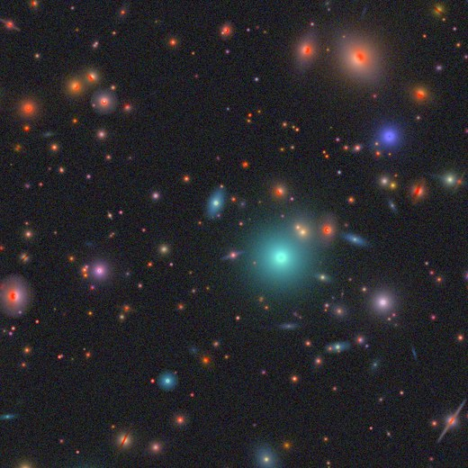

Lightcone images
================

:mod:`dendros.viz` can turn a Galacticus lightcone into a mock observed image: every
galaxy crossing the lightcone is rendered from the model's own description of it, at its
position on the sky, its angular size and its observed brightness, in observed-frame
bands such as JWST/NIRCam's.

*A 36" part of a 3'×3' mock NIRCam (F115W/F200W/F444W) field from a lightcone through the
milli-Millennium simulation, with 6150 galaxies at 0.1 < z < 8.*

What is done for each galaxy:

* its density grids and observed-frame luminosities (of all stars and, optionally, of
  young stars) are read, as for :func:`~dendros.viz.galaxy_scene`;
* it is rendered at the angular scale given by the angular diameter distance at its
  redshift, with dust absorbing at the rest-frame wavelength (the band's divided by 1+z);
* its luminosity per unit area becomes flux [nJy] through the luminosity distance, with
  the factor 1/(1+z) that Galacticus' observed-frame luminosities leave out:
  :math:`m = -2.5\log_{10} L + 5\log_{10}(D_\mathrm{L}/10\,\mathrm{pc}) - 2.5\log_{10}(1+z)`;
* its disk is oriented along its halo's spin vector, if the model presets 3-D angular
  momenta from the merger trees, and otherwise at random (Galacticus predicts no
  orientation itself).

The bands are then convolved with a Gaussian point-spread function, and noise may be
added for a chosen depth.

Model requirements
------------------

A lightcone needs complete merger trees for a contiguous simulation volume (replicated to
fill the cone), with positions. The model writes each galaxy where it crosses the
lightcone (the ``lightconeCrossing`` time-stepper with a ``Lightcone`` outputter), and
must output, besides the ``densityProfile`` grids of :doc:`viz`:

.. code-block:: xml

   <nodePropertyExtractor value="lightcone">
     <atCrossing                value="true"/>
     <includeObservedRedshift   value="true"/>
     <includeAngularCoordinates value="true"/>
   </nodePropertyExtractor>
   <nodePropertyExtractor value="spin"/>
   <!-- For each component (disk, spheroid): all stars, with IGM absorption ... -->
   <nodePropertyExtractor value="luminosityStellarFromStarFormationHistory">
     <filterNames value="JWST_NIRCAM_f115w JWST_NIRCAM_f200w JWST_NIRCAM_f444w"/>
     <component   value="disk"/>
     <frame       value="observed"/>
     <redshiftMinimum value="0.01"/>
     <redshiftMaximum value="8.5"/>
     <stellarPopulationSpectraPostprocessor value="inoue2014"/>
   </nodePropertyExtractor>
   <!-- ... and young stars (formed in the last 100 Myr), with IGM absorption. -->
   <nodePropertyExtractor value="luminosityStellarFromStarFormationHistory">
     ...
     <stellarPopulationSpectraPostprocessor value="sequence">
       <stellarPopulationSpectraPostprocessor value="recent">
         <timeLimit value="0.1"/>
       </stellarPopulationSpectraPostprocessor>
       <stellarPopulationSpectraPostprocessor value="inoue2014"/>
     </stellarPopulationSpectraPostprocessor>
   </nodePropertyExtractor>

The luminosities are then named ``diskStellarSFH:inoue2014:<filter>:observed`` (all stars)
and ``diskStellarSFH:sequence:<filter>:observed`` (young stars).

Making an image
---------------

.. code-block:: python

   from dendros import open_outputs
   from dendros.viz import lightcone_field, render_lightcone, add_noise
   from astropy.visualization import make_lupton_rgb

   B, G, R = "JWST_NIRCAM_f115w", "JWST_NIRCAM_f200w", "JWST_NIRCAM_f444w"
   with open_outputs("lightcone.hdf5", output_root="Lightcone") as c:
       field = lightcone_field(c, bands=(B, G, R), mass_minimum=1.0e7)
   images = render_lightcone(field, (B, G, R), pixel_scale=0.04,
                             psf_fwhm={B: 0.040, G: 0.066, R: 0.145},
                             young_scale_height={"disk": 0.3})
   noisy = add_noise(images, depth={B: 29.5, G: 29.5, R: 29.5}, pixel_scale=0.04)
   rgb = make_lupton_rgb(noisy[R], noisy[G], noisy[B], minimum=-0.13, stretch=1.0, Q=8.0)

:func:`~dendros.viz.lightcone_field` reads the galaxies and the lightcone's geometry and
cosmology (from the model's ``Parameters``). :func:`~dendros.viz.render_lightcone`
renders each galaxy on its own stamp, ``extent`` stellar half-mass radii across, at up
to ``oversample`` times the pixel resolution, fading the stamp out over its outer
``taper`` fraction so that no edge shows, and adds it into the field; galaxies are
rendered in parallel threads. The images are in nJy per pixel.
:func:`~dendros.viz.add_noise` adds Gaussian noise for a 5σ point-source depth in a
circular aperture. The presentation options of :doc:`viz` (``young_scale_height``,
``texture``) apply here too.

Rendering takes about a second per galaxy (in one thread), so a few thousand galaxies
take tens of minutes.
