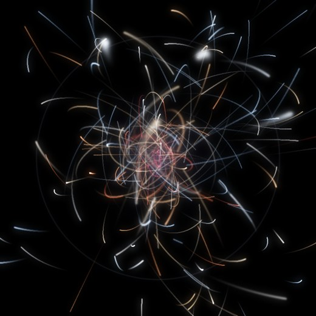

Subhalo orbits
==============

:mod:`dendros.viz` can animate the subhalos of a host halo along their orbits. Each
subhalo is a glowing point with a fading trail along its recent orbit. The trail's width
follows the subhalo's bound mass at each moment, so tidal stripping shows as trails
thinning along the orbit, and its color is the fraction of the subhalo's peak mass still
bound (blue-white: intact; red: mostly stripped). Subhalos that host a galaxy have a gold
core.

*The subhalos of a Milky-Way-mass halo today, with trails covering their last 1.5 Gyr.*

Model requirements
------------------

Orbits need closely spaced outputs: about every 25 Myr gives smooth trails. To keep the
output small, write only the host's main branch and the subhalos, with the
``orbiting`` satellite component (for ``satelliteBoundMass``) and these node property
extractors:

.. code-block:: xml

   <componentSatellite value="orbiting"/>

   <outputTimes value="list">
     <times value="1.0 1.025 1.05 ... 13.8"/>   <!-- every 25 Myr -->
   </outputTimes>

   <nodePropertyExtractor value="multi">
     <nodePropertyExtractor value="nodeIndices"/>
     <nodePropertyExtractor value="indicesTree"/>
     <nodePropertyExtractor value="positionOrbital"/>
     <nodePropertyExtractor value="virialProperties"/>
   </nodePropertyExtractor>

   <galacticFilter value="any">
     <galacticFilter value="haloNotIsolated"/>
     <galacticFilter value="mainBranch"/>
   </galacticFilter>

``positionOrbital`` gives each subhalo's position relative to its top-level host, so
subhalos of subhalos are placed correctly. A Milky-Way-mass host at a halo mass
resolution of :math:`10^8\,\mathrm{M}_\odot`, with 513 outputs, runs in a few minutes.

Reading and drawing
-------------------

:func:`~dendros.viz.subhalo_orbits` collects the orbits of the subhalos of one tree's
host. A subhalo is kept at an output if its chain of hosts leads to the host's main
branch, so the subhalos of other halos join once those halos have fallen in.
:func:`~dendros.viz.render_orbits` draws one moment, and
:func:`~dendros.viz.compose_orbit_animation` makes a video:

.. code-block:: python

   from dendros import open_outputs
   from dendros.viz import subhalo_orbits, render_orbits, compose_orbit_animation

   with open_outputs("orbits.hdf5") as c:
       orbits = subhalo_orbits(c, tree_index=4)
   image = render_orbits(orbits, k=-1, npix=1080)          # today, as an RGB image
   compose_orbit_animation(orbits, "orbits.mp4")           # the whole history

Options of :func:`~dendros.viz.render_orbits` include the length of the trails
(``trail``, in Gyr), the view (``elevation`` above the host's x-y plane and ``azimuth``
about its z axis), the smallest bound mass drawn (``mass_minimum``), the widths
(``width_scale``) and the stellar mass above which a subhalo counts as hosting a galaxy
(``galaxy_mass_minimum``). Light from overlapping trails adds, and a tone curve lets
dense regions saturate gracefully.

:func:`~dendros.viz.compose_orbit_animation` shows one output per frame. Its view spans
``zoom`` times the host's virial radius, smoothed over time, so it follows the host's
growth (the scale bar adjusts), and turns by ``turn`` degrees over the animation.
Frames are labeled with the time, redshift and number of subhalos, with a key to the
colors. Rendering takes about a second per 1080-pixel frame.
