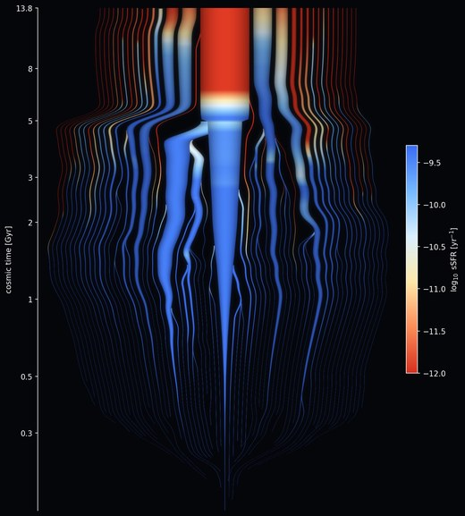
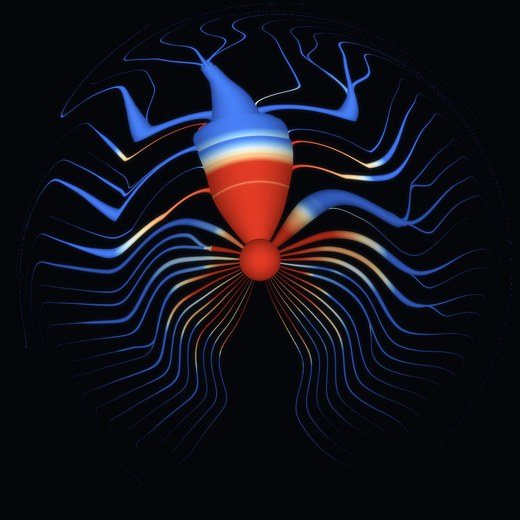
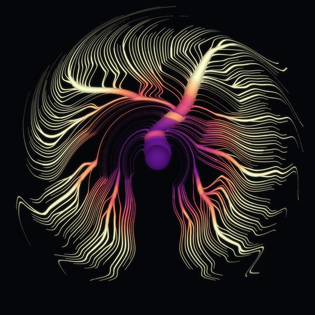
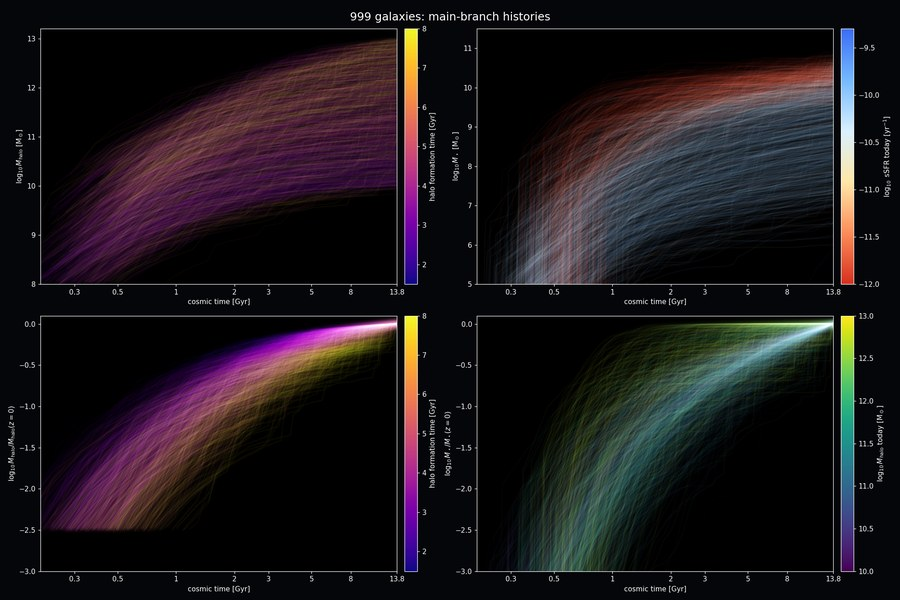

Merger tree diagrams
====================

:mod:`dendros.viz` draws the galaxy merger tree of a galaxy as a "river": each branch
(the history of one galaxy until it merges) is a ribbon running up the page with
time. The ribbon's width is set by the galaxy's mass, and its color by a property
such as its specific star formation rate. Progenitors flow into the galaxy they
merge with. Galaxies that are satellites at the end can be drawn as well, as
streams that run alongside the central galaxy without joining it.

*The galaxy merger tree of a Milky-Way-mass halo, colored by specific star
formation rate (blue: star-forming; red: quenched). The central galaxy quenches at
about 5.5 Gyr; its surviving satellites, at the edges, quench after falling in.*

Model requirements
------------------

The model must run Galacticus' ``galaxyMergerTree`` node operator, which samples
galaxy properties along every branch of each galaxy's merger tree, and output its
data with the ``galaxyMergerTree`` node property extractor:

.. code-block:: xml

   <!-- Inside the model's nodeOperator value="multi" list: -->
   <nodeOperator value="uniqueIDBranchTip"/>
   <nodeOperator value="galaxyMergerTree">
     <timeStep value="0.1"/>
     <nodePropertyExtractor value="massStellar"/>
     <nodePropertyExtractor value="starFormationRate">
       <component value="total"/>
     </nodePropertyExtractor>
   </nodeOperator>

   <nodePropertyExtractor value="multi">
     <nodePropertyExtractor value="nodeIndices"/>
     <nodePropertyExtractor value="galaxyMergerTree"/>
   </nodePropertyExtractor>

``timeStep`` [Gyr] is the shortest interval between samples. Any scalar property
extractor can be added to the list, and is then available for coloring (see below).
The default widths and colors need ``massStellar`` and ``starFormationRate``.

The galaxies in the tree are those the model resolves, so the halo mass resolution
sets how many branches there are. A Milky-Way-mass halo with a resolution of
:math:`10^9\,\mathrm{M}_\odot` gives a few dozen branches, and one with a resolution of
:math:`10^8\,\mathrm{M}_\odot` gives a few hundred.

Drawing a tree
--------------

:func:`~dendros.viz.galaxy_merger_tree` reads the tree of the central galaxy of one
merger tree, :func:`~dendros.viz.river_layout` lays it out, and
:func:`~dendros.viz.draw_river_tree` draws it:

.. code-block:: python

   import numpy as np
   import matplotlib.pyplot as plt
   from dendros import open_outputs
   from dendros.viz import galaxy_merger_tree, river_layout, draw_river_tree

   with open_outputs("trees.hdf5") as c:
       tree = galaxy_merger_tree(c, "Output1", tree_index=4)
   layout = river_layout(tree, mass_minimum=1.0e6, n_times=1600)

   plt.style.use("dark_background")
   fig, ax = plt.subplots(figsize=(9, 12))
   mappable = draw_river_tree(ax, tree, layout)
   ticks = np.array([0.3, 0.5, 1, 2, 3, 5, 8, 13.8])
   ax.set_yticks(layout.coordinate(ticks), [f"{t:g}" for t in ticks])
   ax.set_ylabel("cosmic time [Gyr]")
   ax.set_xticks([])
   fig.colorbar(mappable, ax=ax, label="log10 sSFR [1/yr]")

``include_satellites=False`` in :func:`~dendros.viz.galaxy_merger_tree` leaves out
the trees of the central's surviving satellites.

Layout
~~~~~~

Around each branch, the branches merging into it are stacked outwards on alternating
sides, in order of merger time, with the earliest to merge innermost; surviving
satellites lie outermost. A branch's ribbon therefore never has to cross another to
reach the branch it merges into. Each branch reserves space for itself and for
everything merging into it, so ribbons do not overlap. Space opens smoothly as a
branch appears and closes after it merges. As it merges, a branch swoops into its
parent's ribbon over a time of ``2 * transition``.

Options of :func:`~dendros.viz.river_layout`:

``exponent``
    Ribbon widths scale as mass to this power (default 0.5). With 1, widths add at
    each merger, but minor progenitors are too thin to see.
``axis``
    ``"log"`` (the default) spaces times logarithmically, which spreads out the early
    epochs when most mergers happen; ``"linear"`` spaces them evenly.
    :meth:`~dendros.viz.RiverLayout.coordinate` converts times to the vertical
    coordinate, e.g. for axis ticks.
``mass_minimum``
    Omit branches that never reach this mass, together with everything merging into
    them.
``gap``, ``transition``, ``n_times``
    The space between ribbons, the duration of the opening and closing of space, and
    the number of times in the layout (which is also the number of image rows).

Rendering
~~~~~~~~~

:func:`~dendros.viz.render_river` renders the layout as an image, one row per
layout time, and :func:`~dendros.viz.draw_river_tree` shows that image on a
matplotlib Axes. Each ribbon is shaded across its width like a lit tube
(``shading``), drawn over the ribbons that merge into it, and given a soft glow
(``glow``, ``glow_sigma``). Surviving satellites are dimmed by
``satellite_brightness``.

By default ribbons are colored by the logarithm of the specific star formation rate,
from :math:`10^{-12}` (red, quenched) to :math:`10^{-9.3}\,\mathrm{yr}^{-1}` (blue,
star-forming), using :func:`~dendros.viz.river_colormap`.

.. note::

   In Galacticus versions before the fix of 2026-11, models using the ``blitz2006`` disk
   star formation rule recorded the wrong star formation rate for the central galaxy at
   many mergers: that of the merging satellite, usually far smaller. The central then
   appears to stop forming stars at the instant of each minor merger, which shows as
   thin red bands across its ribbon. The model's evolution was not affected, only the
   values recorded at mergers.

To color by something else, pass ``color``: a function of a
:class:`~dendros.viz.Branch` returning a value at each of its sample times, with a
matplotlib ``norm`` (and optionally ``cmap``). For example, to color by gas fraction
(with ``massISM`` added to the ``galaxyMergerTree`` operator's extractors):

.. code-block:: python

   from matplotlib.colors import Normalize

   def gas_fraction(branch):
       gas = branch.properties["MassISM"]
       return gas / (gas + branch.properties["MassStellarTotal"])

   draw_river_tree(ax, tree, layout, color=gas_fraction, norm=Normalize(0.0, 1.0))

The names in ``Branch.properties`` are those of the output datasets without the
``galaxyMergerTree`` prefix.

Radial diagrams
---------------

The same tree can be bent into a circle, with the final galaxy at the center and the
earliest progenitors at the rim. :func:`~dendros.viz.radial_layout` lays it out and
:func:`~dendros.viz.render_radial` renders it:

.. code-block:: python

   import matplotlib.pyplot as plt
   from dendros.viz import radial_layout, render_radial

   layout = radial_layout(tree, mass_minimum=1.0e6, n_times=1600)
   image, mappable = render_radial(tree, layout, npix=1600)
   plt.imsave("radial.png", image)

Time runs inwards, so the final galaxy fills the inner circle (of radius ``inner``, in
units of the image half-width; pass the same value to both functions), drawn in its
final color. Position across the river becomes the angle.

Options of :func:`~dendros.viz.render_radial`:

``fill``
    Stretch the tree at each radius to span the whole circle (the default), as in a
    classic radial tree. Without it the tree keeps the shape of the river diagram, and,
    being narrow at early times, fills only part of the rim. The stretch changes slowly
    with radius, so ribbons do not wobble.
``angle``
    The angle spanned, in degrees: 360 (the default) for a full circle, or less for a fan
    opening upwards.
``core``
    Fill the inner circle with the final galaxy.

Bent into a circle, a layout spans the same angle at every radius, so ribbons are drawn
narrower towards the center, where rings are shorter. ``compensation`` in
:func:`~dendros.viz.radial_layout` scales widths by ``(inner/r)**compensation`` to
counter this: 1 makes widths true lengths, but then the early tree, narrow compared
with the long rings near the rim, fills only part of the circle; the default is 0.
:func:`~dendros.viz.radial_layout` also smooths the layout over longer time scales than
:func:`~dendros.viz.river_layout` (``smoothing`` and ``transition``), as sideways shifts
of the ribbons are more prominent once bent into a circle.

Dark matter halo trees
----------------------

The merger tree of the dark matter halos can be drawn in the same ways. Halos merge
when one falls into another, typically long before their galaxies merge, so the halo
tree differs from the galaxy tree. :func:`~dendros.viz.halo_merger_tree` reads the
tree as it was before evolution, which the ``outputStructure`` merger tree operator
writes:

.. code-block:: xml

   <mergerTreeOperator value="outputStructure">
     <nodePropertyExtractor value="multi">
       <nodePropertyExtractor value="nodeIndices"/>
       <nodePropertyExtractor value="massBasic"/>
       <nodePropertyExtractor value="time"/>
     </nodePropertyExtractor>
   </mergerTreeOperator>

Each halo's main progenitor is its most massive one. A branch follows main progenitors
back in time, and merges into the branch of its descendant at the descendant's time.
The tree has the same form as a galaxy merger tree, with the halo mass as the property
``"MassBasic"``:

.. code-block:: python

   from matplotlib.colors import Normalize
   from dendros.viz import halo_merger_tree, halo_growth_rate

   with open_outputs("trees.hdf5") as c:
       halos = halo_merger_tree(c, tree_index=4)
   layout = radial_layout(halos, mass="MassBasic", mass_minimum=1.0e9, gap=0.03, n_times=1600)
   image, mappable = render_radial(halos, layout, npix=1600, color=halo_growth_rate,
                                   norm=Normalize(-1.6, 0.6), cmap=plt.get_cmap("magma"))

*The halo merger tree of the same Milky-Way-mass halo, colored by specific growth rate:
progenitors grow fast at early times (pale) and the halo slowly today (purple).*

:func:`~dendros.viz.halo_growth_rate` gives the logarithm of the specific growth rate
[Gyr⁻¹], averaged over the preceding ``window`` (1 Gyr by default) to smooth over the
jumps in mass at mergers. Halo trees have many more branches than galaxy trees, so a
smaller ``gap`` and a higher ``mass_minimum`` suit them.

A galaxy's life story
---------------------

Renders of a galaxy through time can be set beside its merger tree, in a figure or an
animation. :func:`~dendros.viz.render_main_branch` renders the galaxy on the main branch
of a tree at each output in which it is present; it finds it by the unique ID of its
branch tip, which the model must output (the ``uniqueIDBranchTip`` node property
extractor), alongside everything :func:`~dendros.viz.galaxy_scene` needs (see
:doc:`viz`).

.. code-block:: python

   from dendros.viz import galaxy_merger_tree, render_main_branch, life_story_figure

   with open_outputs("life.hdf5") as c:
       tree = galaxy_merger_tree(c, "Output9", tree_index=4)   # the tree, from the final output
       frames = render_main_branch(c, tree, directory="renders")
   fig = life_story_figure(tree, frames)
   fig.savefig("life.png", facecolor=fig.get_facecolor())

Each frame is rendered by :func:`~dendros.viz.presentation_render` by default: the
presentation options of :ref:`viz-presentation`, at a fixed physical scale (a half-width
of 25 kpc), so that the galaxy's growth is seen. Pass ``render`` to change this; it is
called as ``render(scene, azimuth=...)``. With ``directory``, renders are saved and
reused, so an interrupted run resumes where it stopped, and the color stretch can be
changed without rendering again (:func:`~dendros.viz.load_story_frames` reloads them).

:func:`~dendros.viz.life_story_figure` draws the tree as a horizontal river, with the
renders above it, each joined to the moment it shows on the main branch.

Animations
~~~~~~~~~~

:func:`~dendros.viz.compose_story_animation` makes a video from renders at many outputs:
the galaxy on the left, labeled with its redshift, time, stellar mass and star formation
rate, and on the right the tree, revealed up to the current time, with a marker on the
main branch. An in-between frame blends each pair of consecutive renders. Frames are
written as PNG files and encoded with ``ffmpeg``, which must be installed.

.. code-block:: python

   frames = render_main_branch(c, tree, directory="renders", turns=1.5)   # turning slowly
   main = tree.branches[tree.root]
   compose_story_animation(
       full_tree, frames, "life.mp4",
       star_formation=lambda t: np.interp(t, main.time, main.properties["TotalStarFormationRate"]) / 1.0e9)

For a smooth animation, a model needs many outputs (100-150, spaced logarithmically in
time, suit a galaxy's whole history). To keep the output file small, write only the
main branch of each tree with the ``mainBranch`` galactic filter. That filter also
removes the satellites from the galaxy merger tree, so the tree shown (``full_tree``
above) may be read from a separate run of the same model with few outputs and no filter.
The merger trees of the two runs are identical, but galaxy properties can differ
slightly, because the output times affect the time-stepping (by about 7% in final
stellar mass in our tests), so take the labels' star formation rate from the animated
run itself. Rendering about 150 frames of 512²
pixels takes some 40 minutes.

Many histories at once
----------------------

The main-branch histories of thousands of galaxies can be drawn together, as lines of
light that add, so that the typical paths glow brightly and the spread around them shows
as a fainter haze. :func:`~dendros.viz.main_branch_histories` collects the history of the
central galaxy of every tree in a model (which must run the ``galaxyMergerTree``
operator), and :func:`~dendros.viz.draw_tracks` draws any set of tracks on matplotlib
axes:

.. code-block:: python

   import numpy as np
   from matplotlib.colors import Normalize
   from dendros.viz import main_branch_histories, draw_tracks

   with open_outputs("population.hdf5") as c:
       h = main_branch_histories(c)
   formation = h.time_fraction("MassBasic", 0.5)       # when each halo reached half its final mass
   fig, ax = plt.subplots()
   draw_tracks(ax, [np.log10(t) for t in h.time], [np.log10(m) for m in h.properties["MassBasic"]],
               formation, extent=(np.log10(0.2), np.log10(13.8), 8.0, 13.2),
               cmap=plt.get_cmap("plasma"), norm=Normalize(1.5, 8.0), brightness=0.05)

*The main-branch histories of 999 central galaxies in halos of 10¹⁰ to 10¹³ M☉. Bottom right:
galaxies in massive halos (yellow) assembled their stars early, those in low-mass halos
(blue) steadily ("downsizing"). The floor in the bottom-left panel is the mass resolution.*

Each track is colored by one value (as here) or by an array of values along it. A single
line contributes ``brightness`` to the image, and where many coincide their light adds;
a tone curve lets dense regions saturate gracefully. ``width`` sets the line width in
pixels, and ``glow`` a soft halo. :meth:`~dendros.viz.Histories.final` and
:meth:`~dendros.viz.Histories.time_fraction` give per-galaxy values to color by.

To sample halos evenly in log mass, give the ``sampledDistributionUniform`` tree-mass
sampler a ``powerLaw`` distribution with exponent 0 (its default exponent, 1, favors low
masses), and write only centrals with the ``haloIsolated`` galactic filter:

.. code-block:: xml

   <mergerTreeBuildMasses value="sampledDistributionUniform">
     <massTreeMinimum value="1.0e10"/>
     <massTreeMaximum value="1.0e13"/>
     <treesPerDecade  value="333"/>
     <mergerTreeBuildMassDistribution value="powerLaw">
       <exponent value="0.0"/>
     </mergerTreeBuildMassDistribution>
   </mergerTreeBuildMasses>
   <galacticFilter value="haloIsolated"/>
